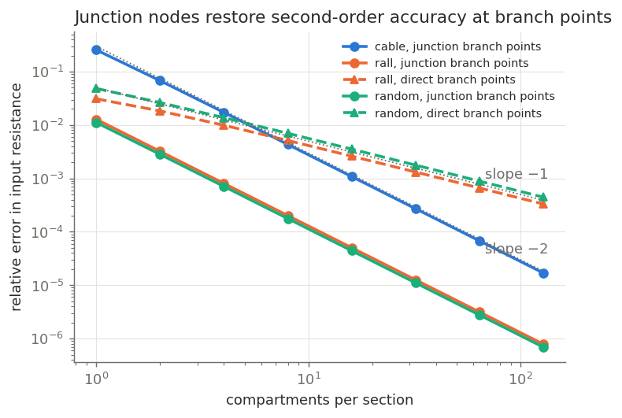
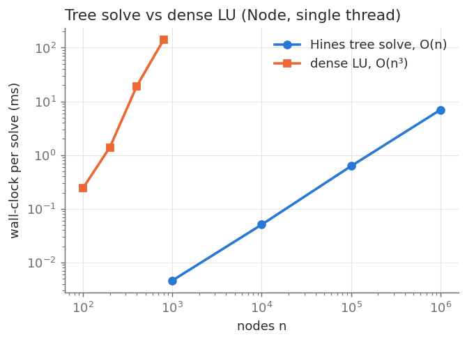
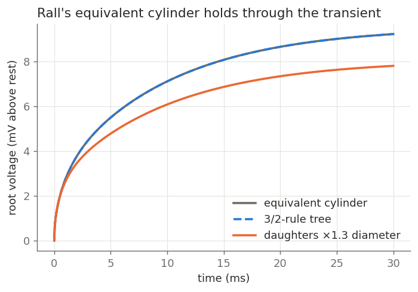
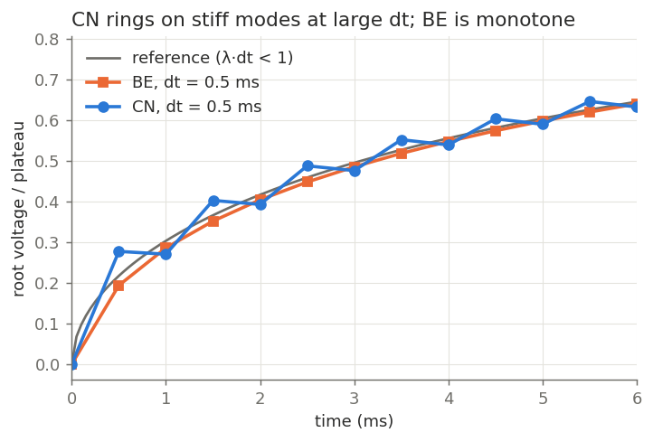
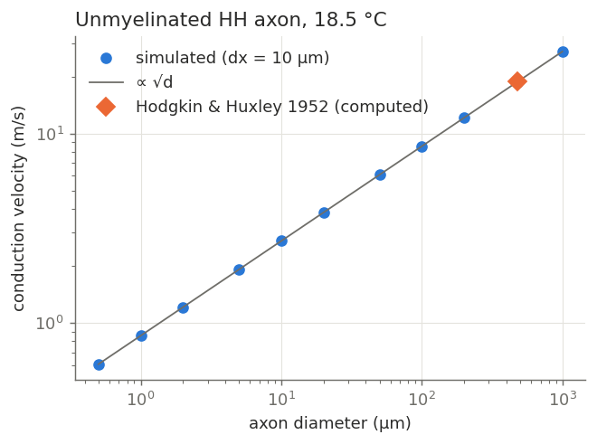

# dendritic-cable-solver

A compartmental neuron simulator built around the **Hines algorithm**: Gaussian
elimination on tree-structured matrices in O(n), with zero fill-in. Every
numerical claim is checked against an independent reference: exact passive cable
theory (Rall), dense LU, closed-form eigenvalues, or the conduction velocity that
Hodgkin & Huxley computed by hand in 1952.

TypeScript (runs directly on Node ≥ 22.6, no build step) with no runtime
dependencies. Python/matplotlib is used only to draw figures.



## Why this problem

A neuron's dendrites and axon form a tree. Discretising the cable equation

    C_m ∂V/∂t = (d / 4R_a) ∂²V/∂x² − I_ion(V, gates) + I_inj

on a branched morphology gives a linear system at every implicit time step.
Its matrix has nonzeros only on the diagonal and along the tree's edges. A
general sparse or dense solver ignores that structure. The Hines observation is
that **if every node is numbered after its parent, eliminating nodes in reverse
order always removes a leaf**. A leaf touches only its parent, so elimination
updates a single diagonal entry and creates no fill. The whole solve is two
sweeps of about 2n multiply-adds.

Getting the solver right is only half the job. A simulator is only as good as
its discretisation, so this repo also measures what each numerical choice
actually costs:

- How branch points are coupled (spatial order).
- Backward Euler vs Crank–Nicolson with staggered gates (temporal order, stiffness).
- Explicit vs implicit integration (stability).

## What's inside

| File | What it does |
|---|---|
| `src/hines.ts` | `TreeMatrix`: an O(n) tree solve, a mat-vec, and a dense export. It checks Hines ordering (`parent[i] < i`). |
| `src/dense.ts` | Reference dense LU with partial pivoting, plus **symbolic elimination** that counts the fill-in of any elimination order. |
| `src/morphology.ts` | Section-based tree builder (Hines-ordered output) with two branch-point schemes: `direct` and zero-area `junction` nodes. Also Rall 3/2-rule trees and random dendrites. |
| `src/cable.ts` | `CableModel` (areas, capacitances, axial conductances, passive steady state, λ_max by power iteration) and `Simulator`: **BE**, **CN** (NEURON-style half-step + extrapolation, staggered gates), and **FE**. |
| `src/hh.ts` | Hodgkin–Huxley 1952 kinetics, Q10 = 3, and exact exponential-Euler gate updates. |
| `src/analytic.ts` | Rall cable theory: λ, G∞, the finite-cylinder load formula, the exact leaves-up input resistance of any tree, the sealed-cable cosh profile, and the equivalent cylinder. |
| `src/experiments.ts` | Five experiments (E1–E5). Writes `results/results.{md,json}`. |
| `scripts/plot.py` | Renders `figures/*.png` from the JSON. |
| `tests/` | 15 `node:test` tests. |

### Design notes

- **Absolute-current formulation.** Each node obeys KCL in absolute units (µF,
  mS, µA), not per-area densities, so the axial matrix is symmetric. Zero-area
  nodes are then simply rows with no capacitance. Units: mV, ms, mS·mV = µA,
  µF·mV/ms = µA.
- **Linear implicit steps.** Within a step the gates are held fixed, so every
  ionic current is `g(gates)·(V − E)`, which is linear in V. Each step is
  therefore exactly one tree solve with no Newton iteration. CN staggers gates at
  half steps (Hines' scheme), so the whole scheme stays second order.
- **Junction nodes.** With `direct` coupling, a parent whose last compartment
  feeds k children contributes its distal half-resistance k times *in
  parallel*, when it should contribute once in series. A zero-area node at the
  branch point fixes this, which is what NEURON does. E2 shows the scheme
  changes the convergence order.

## Results

All numbers below come from `npm run exp` (11 s total; full output in
[`results/results.md`](results/results.md)). Everything is **simulation**. The
only physical comparison is HH's own 1952 computation. Wall-clock timings are
from one machine (Node 22, single thread) and are meant only to show scaling.

### E1. The solver

- Hines vs dense LU on 30 real backward-Euler cable matrices: max relative
  difference **6.4e-16**.
- **Fill-in** (symbolic elimination on random recursive trees, n = 1000):
  leaves-first **0**; random order 7,923; root-first **250,933**, which is half of
  a dense matrix's 499,500.
- **Scaling:** Hines is **4.7–7.1 ns/node** from 10³ to 10⁶ nodes (fitted
  exponent 1.06; the per-node cost rises once the arrays leave cache). Dense LU
  has exponent 2.70. At n = 800, Hines is **~19,000× faster** (0.004 ms vs 74 ms).



### E2. Spatial convergence against exact cable theory

The reference is the exact steady-state input resistance from Rall's
leaves-up recursion `G_in = G∞(B + tanh X)/(1 + B tanh X)`.

| geometry | branch points | err @ nseg = 1 | err @ nseg = 128 | observed order |
|---|---|---|---|---|
| unbranched cable | – | 0.256 | 1.7e-5 | **2.00** |
| Rall 3/2 tree | junction | 0.0128 | 7.9e-7 | **2.00** |
| Rall 3/2 tree | direct | 0.0311 | 3.3e-4 | **0.99** |
| random 25-section tree | junction | 0.0112 | 6.9e-7 | **2.00** |
| random 25-section tree | direct | 0.0485 | 4.5e-4 | **1.00** |

**Direct compartment-to-compartment coupling at branch points silently drops the
scheme to first order.** At 128 compartments per section it is 420–650× less
accurate than junction nodes, for essentially the same node count.

**Rall's equivalent cylinder.** The exact R_in of a 4-generation 3/2-rule tree
matches its equivalent cylinder to all printed digits (95.456165 MΩ). In the
transient response to a current step, the simulated tree–cylinder gap shrinks
with refinement: 6.9% → 2.1% → 0.49% → 0.12% at 4/8/16/32 compartments in the
root section. When the 3/2 rule is broken (daughters ×1.3 diameter), the gap
settles at a grid-independent **15.4%**.



### E3. Time stepping

Max voltage error at a distal tip of a 3-generation tree (CN reference at
dt = 1.95e-4 ms):

| membrane | method | err @ dt = 0.1 ms | err @ dt = 0.00625 ms | order |
|---|---|---|---|---|
| passive | BE | 0.092 mV | 0.0064 mV | 0.96 |
| passive | CN | 0.0039 mV | 1.7e-5 mV | 1.98 |
| HH | BE | 61 mV | 4.5 mV | 0.95 |
| HH | CN | 13 mV | 0.053 mV | 1.99 |

The large HH errors are spike-timing shifts: a spike that arrives a little
early or late produces a tens-of-mV pointwise error.

**A negative result for CN: ringing.** On a finely discretised cable (λ_max ≈
8,000 /ms), the CN amplification factor at dt = 0.5 ms is −0.999. The stiffest
modes flip sign every step and hardly decay. Under a current step, CN's
*maximum* error is larger than BE's at both step sizes tested, even though CN is
second order:

| method | dt | direction reversals | max error / plateau | error at 10 ms |
|---|---|---|---|---|
| BE | 0.5 | 0 | 2.35% | 0.31% |
| CN | 0.5 | 19 | 6.02% | 0.96% |
| BE | 0.05 | 0 | 0.49% | 0.25% |
| CN | 0.05 | 199 | 2.13% | **0.0026%** |

CN wins on smooth parts of the solution and loses near discontinuities. BE is
L-stable and never rings.



### E4. Explicit stability

The largest stable forward-Euler dt, found by bisection, matches `2/λ_max(C⁻¹A)`
(power iteration) to 5 significant figures on uniform cables and random
branched trees, and scales as **dx^2.00**. At dx = 2.5 µm forward Euler needs
dt < 6.25e-5 ms, while an implicit step has no limit. A unit test checks
λ_max against the closed form `(g/C)(2 + 2cos(π/n)) + g_L/c_m` for a uniform
sealed chain (agreement 1e-9).

### E5. Conduction velocity

On an unmyelinated HH axon (squid parameters, 18.5 °C, R_a = 35.4 Ω·cm), the
476 µm giant axon conducts at **18.70 m/s**. Hodgkin & Huxley's own 1952
computation gave 18.8 m/s (measured: 21.2 m/s). The result is converged to
about 0.1 m/s by 20 compartments/λ with CN at dt ≤ 0.01 ms. BE at dt = 0.04 ms
gives 18.0 m/s.

Velocity ∝ √d holds with a fitted exponent of 0.5001 on a fixed 10 µm grid
(0.5 to six digits on a λ-scaled grid). **Caveat:** this is a consistency check,
not a discovery. In the continuous cable equation, v ∝ λ/τ_m with τ_m
independent of d, so √d is exact. The λ-scaled discrete system is exactly
self-similar. On the fixed grid, the deviation from 0.5 measures discretisation
error.



## Usage

```bash
npm install          # dev-only: typescript, @types/node
npm test             # 15 tests, < 1 s
npm run typecheck    # tsc --noEmit, strict
npm run exp          # full experiment suite (~11 s) → results/results.{md,json}
npm run exp:quick    # smoke run (~3 s) → results/results-quick.* (git-ignored)
npm run plot         # figures/*.png (needs python3 + matplotlib)
```

As a library:

```ts
import { buildTree, rallTree } from './src/morphology.ts';
import { CableModel, Simulator } from './src/cable.ts';
import { HH_LEAK, HH_SQUID } from './src/hh.ts';

const t = buildTree(rallTree(3, 200, 4, 10), { branch: 'junction', rootNode: true });
const model = new CableModel(t.morph, { cm: 1, ra: 100, ...HH_LEAK, hh: HH_SQUID });
const sim = new Simulator(model, 'cn', 0.025, -65).addStim({ node: 0, amp: 0.3, t0: 1, t1: 3 });
sim.run(20, (s) => console.log(s.t.toFixed(3), s.V[t.last[6]!]!.toFixed(2)));
```

## Tests

`tests/solver.test.ts`:

- Hines vs dense LU on random symmetric and nonsymmetric trees (rel. err < 1e-12).
- Residual < 1e-12 at n = 5000; the input matrix is left unmodified.
- Rejection of non-Hines orderings.
- Zero fill for leaves-first elimination, and exactly (n−1)(n−2)/2 fill for a star eliminated hub-first.
- The tree builder's node counts.

`tests/cable.test.ts`:

- Sealed-cable steady state vs the cosh profile, with refinement ratio ≈ 4.
- 3/2-rule tree ≡ equivalent cylinder (1e-12).
- Junction ratio ≈ 4 vs direct ratio ≈ 2.
- **Exact discrete charge conservation** under BE.
- KCL at zero-area nodes preserved by CN extrapolation.
- BE/CN refinement ratios ≈ 2/4 on a spiking HH tree.
- HH rest stationarity, spike, and gate bounds.
- λ_max vs closed form.
- The FE stability boundary at ±3%.
- 476 µm axon velocity within [18, 19.2] m/s.

## Limitations

- Passive cable theory and HH are the only membrane models. There are no
  synapses, calcium, or other channel types, and no SWC morphology import.
  Random and Rall trees are synthetic.
- Only fixed time steps; there is no adaptive/variable-step (CVODE-style)
  integrator.
- The CN ringing study uses a current step, which is the worst case. Smooth
  inputs ring much less.
- Timings are JavaScript on one machine. The O(n) vs O(n³) contrast is robust;
  the absolute ns/node figures are not portable.
- The `direct` branch scheme is a deliberate ablation. It is not a claim about
  any particular simulator except where stated (NEURON uses zero-area nodes).

## References

- M. Hines (1984). Efficient computation of branched nerve equations. *Int. J. Bio-Medical Computing* 15:69–76.
- W. Rall (1959, 1964). Branching dendritic trees and motoneuron membrane resistivity; theoretical significance of dendritic trees.
- A. L. Hodgkin & A. F. Huxley (1952). A quantitative description of membrane current… *J. Physiol.* 117:500–544.
- N. T. Carnevale & M. L. Hines (2006). *The NEURON Book*, ch. 4 (spatial and temporal discretisation).

## License

MIT
